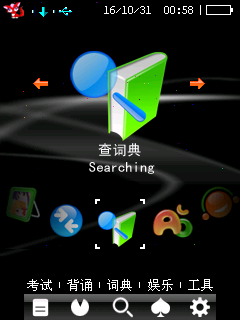

# BBK 9588 / 9688 Debug

BBK 原生 BDA 的后台 USB 调试器，提供状态、RAM 读写、240×320 截图、SDK 服务表调用和 64 KiB 原生模块执行。两个机型的源码、客户端和 BDA 在同一个仓库管理，各自校验固件与设备身份。采用 GPL-3.0-only；来源见 [NOTICE](NOTICE.md)。

## 支持情况

| 目标 | 当前验证范围 |
|---|---|
| 9588 V3.30 / JZ4740 | 新增适配；原厂代码与 38 组 CRC 核对，MIPS/USB/RTOS 模型及完整内核入口的启动/停止/复用、截图诊断通过；真机未验收 |
| 9588 JZ4730 / JZ4720、其他固件 | 尚未启用，不能使用 JZ4740 绑定替代 |
| 9688 V2.32 / JZ4740 | 已完成真机握手、RAM、截图、EXEC、重连及资源清理验证 |
| 9688 V2.32 / JZ4730 | 同一个通用 BDA 内的独立绑定；MIPS/USB 控制器模型通过，真机未验收 |

当前主干为 `0.1.0-alpha.2` 发布候选，新增 9588。已有 [alpha.1 下载](https://github.com/HelloClyde/BBK9588-9688-debug/releases/tag/v0.1.0-alpha.1) 仅包含 9688。9588 可先按下方命令构建；新的成品将在通过发布校验后提供。

## 快速开始

### 从源码构建

Windows PowerShell、Python 3.12：

```powershell
git clone https://github.com/HelloClyde/BBK9588-9688-debug.git
cd BBK9588-9688-debug
git submodule update --init sdk
python -m pip install -r requirements-dev.txt
.\sdk\scripts\setup_toolchain.ps1
python build.py --models all --verify
```

只初始化 `sdk`，无需递归下载模拟器。可以用 `--models 9588` 或 `--models 9688` 单独构建；已有编译器可传 `--toolchain PATH/TO/bin`。构建不需要原厂固件或 BDA 模板，可选的原厂机器码验证只读取本地 ROM。更多命令见 [9588 说明](9588-debug/README.md)、[9688 说明](9688-debug/README.md) 和 [发布说明](docs/RELEASING.md)。

### 安装与连接

| 设备 | 构建文件 | 设备菜单 | PC 客户端 |
|---|---|---|---|
| 9588 V3.30 / JZ4740 | `build/9588-debug/Debug9588.bda` | 9588调试 | `9588-debug/client.py` |
| 9688 V2.32 / 两种芯片 | `build/9688-debug/Debug9688.bda` | 9688调试通用2 | `9688-debug/client.py` |

1. 将与机型、固件匹配的 BDA 复制到设备 `应用/程序/`。安装包按 `9588/`、`9688/` 分目录，选择对应机型。
2. 安全移除并拔掉 USB，在设备上运行调试 BDA。成功提示后返回菜单，再接回 USB。
3. 在电脑安装客户端依赖，并执行对应命令：

```powershell
python -m pip install -r requirements.txt
python 9588-debug/client.py list
python 9588-debug/client.py status
python 9588-debug/client.py screenshot screen.png
# 9688 使用同一命令形式，将路径换为 9688-debug/client.py
```

客户端枚举设备并核验精确握手，不要猜测 COM 号。9588 使用实验性 `07C4:A4A9`；9688 使用 `A4A7`/`A4A8`，两套客户端拒绝串用。截图默认纠正 LCD 的 180° 扫描方向，`--native-orientation` 保留原始方向；9588 的方向目前只在模拟器观察。

再次打开同一 BDA 或执行 `client.py stop` 请求停止。不同运行时版本更新前先重启；停止后磁盘恢复的真机覆盖范围见各机型说明。内存写入使用已确认自有的地址，EXEC 模块需要协作处理取消。

## 截图与验证

下图是 **9688/JZ4740 真机**工具桌面，后台 Debug 已启动，由本项目截图命令取得。


下面是 **9588/JZ4740 未修改C200内核的模拟器**截图。后台驻留截图函数复制实际LCD像素后，经PC客户端默认180°转换为正向；此过程没有USB主机参与。



[9588 完整内核入口诊断](9588-debug/qemu-validation.md) 与 [9688 真机记录](docs/validation/9688-jz4740.json) 均绑定确切 BDA SHA-256。9588 的模型、GDB入口诊断及真机验证分别记录。文件部署、桌面自动启动、输入注入及 GDB 单步不在当前调试协议范围。

## 依赖

- 设备：匹配的原厂固件、可运行原生 BDA 的机器；设备端无需 SDK。
- PC：Python 3.12、pyserial、Pillow，精确版本见依赖文件。
- 开发：MIPS little-endian GCC 15.2.0、pyelftools；Unicorn 用于 MIPS/控制器模型。
- `sdk/` 固定到 `ef3bf3b7328a3a8fa9ba48593c63285300725fb7`，工具链由 SDK 的校验安装脚本提供。

Release 提供 BDA、客户端安装包、展开固定 SDK 的完整对应源码包及 SHA256SUMS。GitHub 自动生成的源码 ZIP 不含子模块内容，独立构建应使用本项目上传的 `-source.zip`。构建和 CI 不扩大真机验收范围。

## 感谢

- 项目维护者 HelloClyde。
- [BBKH1-debug](https://github.com/HelloClyde/BBKH1-debug) 的驻留、USB 与测试参考实现。
- [BBK9588-bda-sdk](https://github.com/HelloClyde/BBK9588-bda-sdk) 的编译、打包与 SDK。
- 提供本地固件、设备与真机验证的贡献者。

上游许可、原作者与来源分别保留，致谢不代替许可；详见 [NOTICE](NOTICE.md)。
