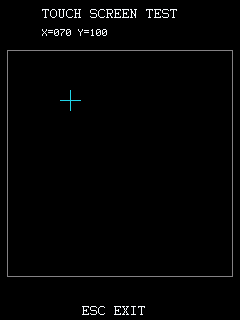

# 0.2.0-alpha.1 流程验证

确切 BDA 与模型检查汇总见 [models](validation/firmware-discovery-workflow-models.json)，完整原内核运行记录见 [9588 workflow](validation/9588-workflow-qemu.json)。公开记录只含源码、地址/CRC 元数据及本项目截图，不分发原厂 ROM/NAND 或设备用户文件。

## 完整原厂内核

9588 / JZ4740 原始 C200 内核，32 MiB RAM，固件零补丁、独立 NAND 副本。Debug 的原生 BDA 入口通过 GDB 放入真实 GUI 任务诊断，并保持任务和栈；随后 GDB 适配器在真实驻留 worker 边界调用编译后的协议 dispatcher。原厂 FS、GUI、调度器、BDA loader 和本项目实际 MIPS 代码均在运行，没有用模型替换这些服务。

最终 `Debug9588.bda` SHA-256：`a41a109ec3959b5bc7df6b2065235eb5cea8c6fbcf935c7f29abcc2a4f8ec382`。

实际通过：

- 启动、精确绑定识别，管理功能六项全部启用。
- 程序与中文资源 bundle 暂存、设备回读 CRC、重命名替换；相同文件再次部署跳过。
- 两次重置/扫描刷新，原厂 loader 启动测试 BDA；完整 ELF 可执行节与 RAM SHA-256 一致，前台 handler 属于该镜像。
- 定向点击 `(70,100)`、回车；测试程序记录 raw keydown、character、keyup、touchdown 和 touchup，各一条，坐标实际为 70/100。
- 整屏 153600 字节、区域 33600 字节的真实 LCD 截图，错误前台目标拒绝，事件日志读取。
- 测试程序退出返回原桌面；Debug 最终进入 STOPPED，last_error=0，原 tick/USB IRQ、INTC、CPM 时钟/PHY 和 GPIO 恢复。

测试程序源码在 [workflow_probe.c](../9588-debug/validation/workflow_probe.c)，源于固定 SDK 触摸示例，增加可写事件计数。公开这份对应源使用固定工具链重新打包，BDA 与测试实际输入逐字节相同（SHA-256 `d4167f76423a6f0113c14c73196aa3bc87a8c62b5c5935899d5229ba77d017cd`）。

此项没有 USB 主机参与，GDB 的耗时和吞吐不能代表 USB 性能。Debug 本身的正常菜单/FAT 加载入口未在此项中替代为已验收；测试应用则确实通过驻留 FS 部署和原厂 loader 启动。其他芯片没有沿用本截图作为完整 OS 运行证据。

## 模型与原始固件

五套目标各自测试真实重定位 MIPS 驻留、控制器/FIFO、协议、CRC、EXEC、任务/中断和管理能力。原厂 ROM 是可选的本地只读输入：启用后核对各自指纹、功能守卫、跨芯片/机型拒绝；地址移动副本只验证发现算法，未将其当作可启动固件。

新增发现测试覆盖独立函数/全局/表移动、损坏 JAL、重复/塌缩映射、错误 MMIO、产品标记和运行态拒绝。管理测试包含原厂 GUI queue/pool 的快路径、预留抬起节点、任务保存上下文和真实 GUI idle 四层返回链；阻塞信号量或队列临界窗口会延后/拒绝投递。无 ROM 的公共构建测试另行记录正常跳过，不能把跳过计为已跑通过。

9688 两控制器还补齐停钟防护：frame、收发、idle、诊断、fault 和 close 的模型均记录零次 gated UDC 读写，包含停止时有待发送数据及 close 等待期间再次停钟。

新增功能尚无五套目标的真机 USB 验收。历史硬件证据只属于原记录中的确切旧 BDA。
